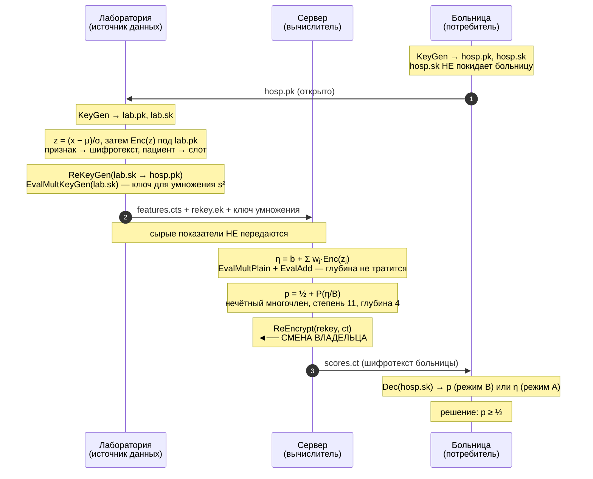

# Движение данных: что, где и под каким ключом

Схема в виде рисунка — `docs/figures/data_flow.svg` (векторный, годится для статьи).
Ниже — та же схема в текстовом виде, трассировка одного значения и таблица видимости.

---

## 1. Идея в одном абзаце

Лаборатория **шифрует показатели у себя** и отдаёт дальше только шифротексты. Сервер
считает по ним логит и вероятность, не имея ни ключей расшифровки, ни самих данных.
Затем сервер выполняет **прокси-перешифрование**: шифротекст, который могла открыть
лаборатория, становится шифротекстом, который может открыть **только больница**.
Секретные ключи при этом никуда не передаются. Больница расшифровывает **один итоговый
результат** — вероятность, — и принимает решение. Сырые показатели не покидают
лабораторию ни на одном шаге.

## 2. Диаграмма последовательности

## 3. Жизненный цикл одного значения

Трассировка показывает, что «владелец» — это не свойство файла, а свойство **ключа,
которым шифротекст открывается**. Значение меняет владельца ровно один раз.

| № | Что лежит | Форма | Под каким ключом | Кто может прочитать |
|---|---|---|---|---|
| 1 | `7.2` — HbA1c пациента, % | открытый текст | — | лаборатория |
| 2 | `1.955` — стандартизованное `z = (7.2 − 5.654)/0.791` | открытый текст | — | лаборатория |
| 3 | `Enc(z)` | шифротекст | `lab.pk` | **лаборатория** (`lab.sk`) |
| 4 | `Enc(η)` — логит | шифротекст | `lab.pk` | лаборатория |
| 5 | `Enc(p)` — вероятность | шифротекст | `lab.pk` | лаборатория |
| 6 | тот же шифротекст после `ReEncrypt` | шифротекст | `hosp.pk` | **больница** (`hosp.sk`) |
| 7 | `0.31` — расшифрованная вероятность | открытый текст | — | больница |

> Шаги 1–2 — арифметическая иллюстрация на реальных `μ = 5,654` и `σ = 0,791` из
> обученной модели (`results/<run-id>/model.json`); это не измерение, а пример
> приведения к стандартизованному масштабу.

Ключевое: **на шаге 6 не расшифровывается ничего**. Меняется лишь то, каким ключом
шифротекст открывается. Ни `lab.sk`, ни `hosp.sk` не перемещаются по сети; сервер
видит только шифротексты на всех шагах, включая шаг 6, и после него расшифровать
результат по-прежнему не может.

## 4. Что делает каждая роль

| Роль | Действия | Что имеет | Чего не имеет |
|---|---|---|---|
| **Больница** | `KeyGen`; получает `hosp.pk`; расшифровывает итог; применяет порог | `hosp.sk`, итоговая вероятность | показателей пациентов, логита (режим B) |
| **Лаборатория** | `KeyGen`; стандартизация; шифрование; `ReKeyGen`; `EvalMultKeyGen` | сырые показатели, `lab.sk`, метаданные модели | `hosp.sk` |
| **Сервер** | логит; сигмоида; `ReEncrypt` | шифротексты, `rekey`, ключ умножения | ключей расшифровки, показателей, результата в открытом виде |

> **Лаборатория — владелец данных, и от неё ничего не скрывается.** Имея `lab.sk` и
> публичную модель, она в принципе может посчитать скор сама. Смысл протокола не в
> том, чтобы что-то скрыть от лаборатории, а в том, чтобы **сервер и больница**
> получили только то, что им положено: сервер — ничего, кроме шифротекстов,
> больница — только итоговую вероятность.

**Модель публична по построению.** Веса, интерцепт, средние `μ` и СКО `σ` — это
метаданные модели, а не данные пациентов: они не зависят от конкретного человека и
передаются лаборатории открыто. Именно поэтому лаборатория может стандартизовать
признаки до шифрования.

## 5. Почему смена владельца безопасна

Ключ перешифрования `rekey` — это не ключ расшифровки. Это «ключ переключения»
(key-switching key), который позволяет перевести шифротекст из-под `lab.pk`
под `hosp.pk` одним алгебраическим преобразованием. Обладая `rekey`:

* можно **перевести** шифротекст на ключ больницы;
* **нельзя расшифровать** ни исходный шифротекст, ни переведённый.

Ключ умножения (релинааризационный) нужен, потому что гомоморфная сигмоида содержит
умножения шифротекст-на-шифротекст. Это стандартный публикуемый ключ для `s²`; он
также не раскрывает `s`.

Проверка этого свойства закреплена тестом
`he::tests::wrong_hospital_key_does_not_recover_plausible_probabilities`: при
расшифровке посторонним ключом библиотека либо отказывает (`Decode` fail-closed),
либо выдаёт неправдоподобные значения — но не исходные вероятности.

Полный разбор модели угроз, включая атаки, от которых прототип **не** защищает, —
`docs/THREAT_MODEL.md`.

## 6. Важно: в репозитории два разных пути

Это стоит держать в голове, чтобы не перепутать демонстрацию с тем, что описано в
статье.

| | Демонстрационные CLI (`lab`, `server`, `hospital`) | Исследовательский контур (`src/he.rs`, `study`) |
|---|---|---|
| Что считается | линейный скор `Σ wⱼxⱼ + b` | логистическая регрессия + сигмоида |
| Что шифруется | **сырые** значения показателей | **стандартизованные** `z` |
| Умножения | только на плейнтекст (`EvalMultPlain`) | ещё и шифротекст-на-шифротекст |
| Ключ умножения | не нужен | **нужен** (`EvalMultKeyGen`) |
| Порог | применяет больница к непрерывному скору | применяет больница к вероятности |
| Роль в работе | демонстрация разделения ролей через файлы | то, что даёт числа статьи |

Демонстрационные CLI специально оставлены как есть: они показывают обмен **только
файлами** между тремя процессами (включая сериализацию ключей и шифротекстов), но
реализуют более простой линейный контур. Исследовательский контур выполняется в одном
процессе, однако шифротексты на каждом шаге сериализуются — именно так измеряются
объёмы передачи. Перенос многочленной сигмоиды в многопроцессный сценарий требует
сериализации ключа умножения; в текущей версии это не сделано и вынесено в
направления дальнейшей работы.
